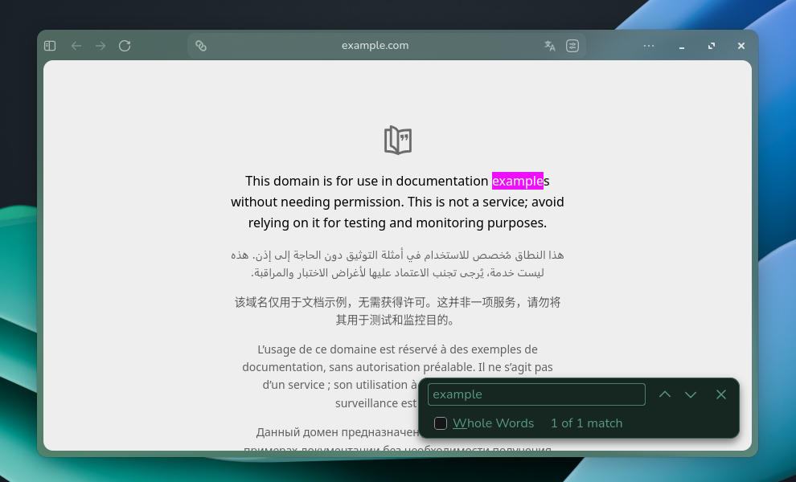
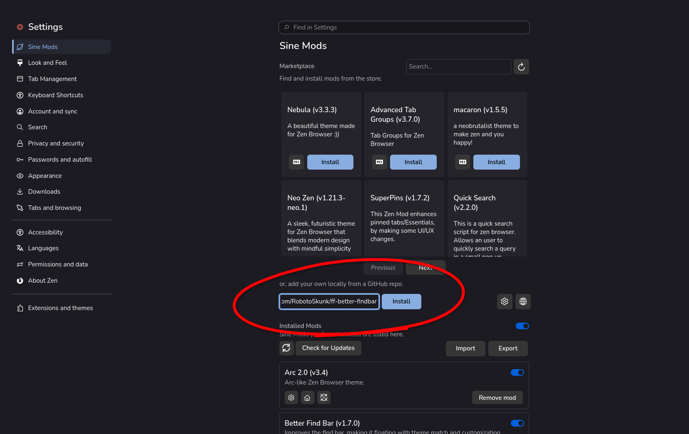
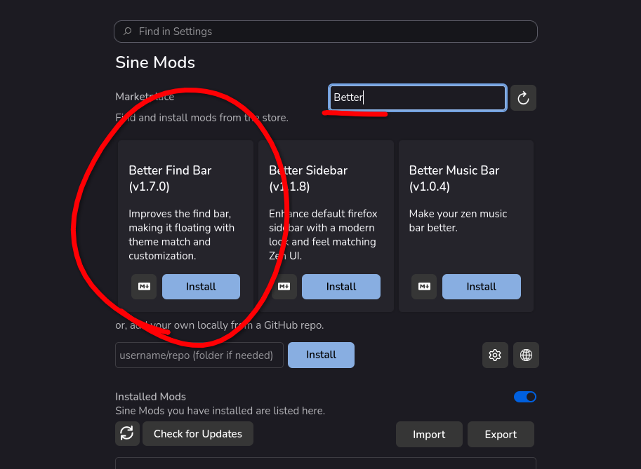

# Better Find Bar

Improves the find bar, making it floating with theme match and customization.

> ### ⚠️ NOTICE FOR ZEN USERS ⚠️
> The Zen Store repository has been archived, so I cannot update the mod in the
> Zen Store. It's recommended using the other methods listed below to install
> the mod along with its corresponding patches.



## Installation

### Install Using Sine (Recommended)
Sine is a community-driven mod/theme manager for all Firefox-based browsers.

#### Method 1 (Recommended)
1. Download the latest stable version of Sine
[from here](https://github.com/CosmoCreeper/Sine/releases) and install it.

2. Copy the repository URL (https://github.com/RobotoSkunk/ff-better-findbar)
and paste it to get the latest updates of the mod.


#### Method 2
> This method does not install the latest mod updates immediately, and updates
> take a couple more days than with the first method.

1. Download the latest stable version of Sine
[from here](https://github.com/CosmoCreeper/Sine/releases) and install it.

2. Search "Better Find Bar" in the marketplace search bar and install it.


### Manual Installation (Traditional Method)
> This method requires a basic understanding of CSS variables to customize the
> search bar.

1. Go to `about:profiles`, open `Root Directory`, then open or create a
lowercase folder named `chrome`.
2. Download the repository ZIP file.
3. Extract the `userChrome.css` file from the ZIP file into the `chrome` folder.
4. Customize the find bar with the custom preferences listed below.

Firefox preferences
```txt
better_findbar.horizontal_position      -> String (left, center, right)
better_findbar.vertical_position        -> String (top, bottom)
better_findbar.transparent_background   -> Boolean
better_findbar.enable_custom_background -> Boolean
better_findbar.enable_custom_text_color -> Boolean
better_findbar.enable_custom_box_shadow -> Boolean
better_findbar.hide_highlight           -> String (not_hide, hide_immediately, hide_on_disable)
better_findbar.hide_match_case          -> String (not_hide, hide_immediately, hide_on_disable)
better_findbar.hide_match_diacritics    -> String (not_hide, hide_immediately, hide_on_disable)
better_findbar.hide_whole_words         -> String (not_hide, hide_immediately, hide_on_disable)
better_findbar.instant_animations       -> Boolean
better_findbar.hide_find_status         -> Boolean
better_findbar.hide_found_matches       -> Boolean
```

CSS variables
```css
:root {
    --better_findbar-custom_background: #aabbcc;
    --better_findbar-custom_text_color: #112233;
    --better_findbar-custom_box_shadow: 0 5px 10px rgba(0, 0, 0, 0.5);
}
```

## Common issues

### The find bar shortly appears and then disappears after trying to open it in Zen
If you installed the mod from the Zen Themes Store, this is why it happens.
Currently, the Zen Themes Store has a highly outdated version of the mod because
it got archived, meaning that no one can publish new mods or update current
ones.

To fix the issue and use the mod, it is suggested to use one of the two methods
listed above to install the latest version.

If the issue still persists after updating the mod to the latest version, please
open an issue.

### The text color is unreadable in Zen browser
The mod uses Zen's primary color for the background and text, which means it is
tied to whatever Zen considers as the "right color choice" for both the
background and the text.

If the color contrast is bad, you can change it to a custom color by enabling
the *"Enable Custom Text Color"* and *"Enable Custom Background Color"*, and
then changing the values to whatever you want.

The mod will get updated over time to fix the issues with the color contrasts
as much as it can, but the custom background and text colors should be good
enough to fix the issues.

### The background blur effect doesn't work
As part of a Firefox update from last year, the backdrop-filter CSS variable is
bugged in some operating systems, mainly on *nix-based operating systems.

There's no way to fix the issue, and it's suggested to disable the find bar
transparency to improve readability until Mozilla fixes the issue.

### The find bar doesn't work properly with this other mod enabled
Some mods or themes modifies the find bar behavior and style by their own,
causing compatibility issues with this mod.

Check if the theme having issues with this mod has an option to disable the
customization of the find bar.

### The find bar can't find some words properly
This mod just injects some custom CSS rules to improve the default looking of
Firefox's find bar, and it doesn't change the find bar behavior.

If the find bar can't find some words properly, please report the issue directly
to Mozilla.
